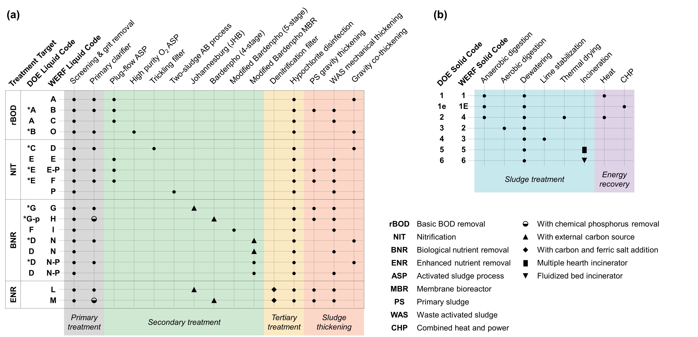
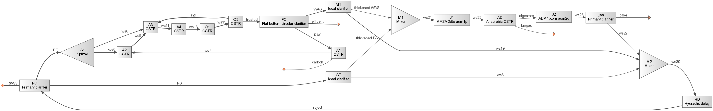

=================================================================================
werf: Benchmark Models for Water Resource Recovery Facilities (WRRF) in the US
=================================================================================

Summary
-------
This module contains benchmark models of typical WRRF configurations in the US [1]_, [2]_. Configuration IDs are indicative of the combination of liquid and solids treatment trains, according to the WERF codes below. 

The original 18 benchmark configurations are available, together with CHP
(``E``-suffix) variants and the D1 trickling-filter configuration. They support
plant-wide dynamic simulations, operational energy demand estimation, and OPEX
accounting.

This module has been used to produce the results in Zhang et al. [3]_ using qsdsan==1.4.3, exposan==1.4.3, biosteam==2.51.19, and thermosteam==0.51.17. Versions of additional packages can be found in `werf.yml <https://github.com/QSD-Group/EXPOsan/blob/main/exposan/werf/werf.yml>`_ .

    *Benchmark liquid and solids treatment trains.*
    

Load the system
---------------
.. code-block:: python

	>>> from exposan import werf
	>>> # `load` constructs the chosen configuration (case-insensitive ID); pass
	>>> # `simulate=True` to also run the (300-d, BDF) plant-wide dynamic simulation.
	>>> werf.load('G1')
	>>> g1 = werf.sys
	>>> # g1.simulate(method='BDF', t_span=(0, 300))  # or: werf.load('G1', simulate=True)
	>>> # Check the states of any one or more components
	>>> # fig, axis = g1.flowsheet.unit.AD.scope.plot_time_series(('S_fa', 'S_bu', 'S_va', 'S_pro', 'S_ac'))
	>>> # fig

    *G1 flow diagram.*

D1 and D1E: treatment versus CHP accounting
-------------------------------------------
``systems/D1E.py`` uses the same ``create_chp_system`` wrapper as F1E and the
other CHP variants. It constructs D1 unchanged and assigns the ``D1E`` ID.
The feed, component definitions, biological rates, initialization, five-layer
TF geometry and TF-specific solver tolerances remain those of D1.

The final clarifier FC uses F1's ``FlatBottomCircularClarifier`` rather than
fixed-efficiency instantaneous separation. It retains F1's 1579.352 m2 area,
3.6576 m depth, ten layers, feed layer five, settling parameters
(``X_threshold=3000``, ``v_max=410``, ``v_max_practical=274``, ``rh=4e-4``,
``rp=0.1``, ``fns=0.01`` and maximum nonsettleable solids of 8 mg/L), and
0.163 MGD waste-sludge flow. The one intentional hydraulic difference is zero
RAS flow, instead of F1's 6.7 MGD: D1 retains biomass on TF media and has no
activated-sludge recycle. FC outlet two (zero-based) carries WAS to the joint
sludge thickener GT; outlet one is an unused zero-flow RAS port. FC startup
matches F1: the last E2P workbook row supplies soluble/solids composition and
``default_fctss_init`` supplies the ten-layer TSS profile. Settling parameters
are a comparative baseline, not a calibration to TF sloughed-solids data.
This requires QSDsan's zero-flow dynamic-stream export: a closed outlet exports
zero material flow while retaining its concentration state and time-series scope.
This replacement changes effluent solids and downstream sludge loading, so
previous D1/D1E performance tables and saved states must be regenerated.

Both configurations read their explicit startup from ``data/initial_conditions.xlsx``:
sheet ``D1`` contains liquid and biofilm concentrations, and row ``D1`` of sheet
``adm`` contains digester concentrations. Section and biofilm-layer indices are
zero-based; layer ``-1`` denotes liquid. Component concentrations are in mg/L on
the component's measurement basis (for example COD, N or P), matching the other
initial-condition sheets. The D1 AD row reproduces the former F1 seed.

The 36 TF rows preserve the previous six-section/five-layer startup exactly:
PAOs receive 1% of heterotroph-plus-PAO COD in each biofilm cell, PP/PAO is 0.17,
PHA/PAO is 0.05, and attached dry solids are 102,000 mg/L. These are explicit
startup assumptions, not measured profiles. D1 no longer generates or normalizes
them at runtime. Editing this sheet is the way to change D1/D1E initial
concentrations; thickness remains a TF constructor setting.

``TricklingFilter.set_init_conc`` reads the two-level section/layer table.
Different uniform grids use overlap-weighted cell averages, preserving the
profile integral for uniform geometry. A matching grid loads unchanged; a
liquid-only TF reads only the liquid rows. Changing density settings does not
silently rescale these workbook concentrations. The programmable E2P-based
startup remains in ESAP's ``systems/TricklingFilter_validation.py`` for SVCW and
standalone calibration, whose components and seeding settings may vary.

The accounting distinction is in ``models.py``, not ``model.py``.
``_has_CHP`` recognizes a system whose ID ends in ``E`` and which contains an
AD unit. ``add_OPEX_metrics`` then includes CHP electricity/heat recovery and
negative operating-cost credits; ``add_downstream_uncertainty`` also includes
heat-price uncertainty. The factory adds neither a physical CHP unit nor CHP
capital costs. D1E does not introduce a new biological simulation.

.. code-block:: python

    from qsdsan import Model
    from exposan import werf

    system = werf.create_system('D1E')
    system.simulate(method='BDF', t_span=(0, 300), rtol=1e-5, atol=1e-6)
    model = Model(system)
    werf.add_OPEX_metrics(model)
    # Evaluate in registration order so shared energy/cost caches are populated.
    values = {metric.name: metric() for metric in model.metrics}
    print(values)

Use freshly simulated D1/D1E states for this comparison. Published baseline
underflow tables and saved steady states for the original configurations do
not provide a calibrated D1 or D1E baseline.

Baseline performance for additional configurations
--------------------------------------------------
``analyses/baseline_performance_extension.py`` runs the baseline workflow for
the original baseline list plus D1 and D1E (27 configurations in total). Add
future registered IDs to its editable ``BASELINE_CONFIGURATIONS`` tuple, or
pass a subset to the callable. The original ``baseline_performance.py`` is
unchanged.

.. code-block:: bash

    python -m exposan.werf.analyses.baseline_performance_extension

The extension uses the same 300-day BDF simulation, metric ordering, empirical
TSS targets, and proportional underflow updates as the original analysis.
Thickened sludge targets 50,000 mg TSS/L; D1/D1E cake targets 180,000 mg TSS/L,
within 1%. TSS is the original proxy for solids percentage, not an independent
total-solids calculation. D1's targeted TF tolerances remain active.
``SIMULATE_KWARGS`` controls the default run settings. Importing the module does
not start simulations; the callable allows a subset or alternate settings:

.. code-block:: python

    from exposan.werf.analyses.baseline_performance_extension import (
        run_baseline_performance_extension,
    )

    metrics = run_baseline_performance_extension(
        configurations=('D1', 'D1E'),
        simulate_kwargs={'rtol': 1e-5, 'atol': 1e-6},
    )

The TF's ``get_retained_mass`` method enables the existing SRT metric by
reporting selected biomass inventory as ``sum(C * i_mass * V)`` over liquid
sections and biofilm layers, in g dry solids. Biofilm volumes use the same
thickness bounds and floors as the dynamic balances. This is reporting only;
it does not change growth, decay, attachment or detachment. Reported SRT keeps
the original WERF convention of dividing retained active biomass by the WAS
biomass loss rate, rather than by all plant-boundary solids losses.

Outputs default to the WERF results directory:

* ``_baseline_unopt_performance_extension.xlsx``: configuration rows and the
  same two-level metric columns as the original analysis, including CHP metrics
  for E-suffix cases.
* ``N_mass_unopt_extension.xlsx`` and ``P_mass_unopt_extension.xlsx``: one sheet
  per successful configuration, using the existing N/P mass-flow helpers.
* ``steady_states/baseline_unopt/<ID>.npy``: each successful case's state vector,
  using the existing per-configuration cache convention. Running a selected
  configuration replaces its previously cached state at this location.

The script starts from factory underflows rather than borrowing another
configuration's calibration. It reports final underflows and AD feed conditions
in the same pass, without a second AD-only simulation loop. Underflow updates
are limited to 30 by default. Failed or unconverged cases are omitted, their
flowsheets are cleared, and errors are recorded in ``metrics.attrs['failures']``.
No workbook is published if every case fails. Output workbooks contain only
successful configurations selected for the current invocation; rerunning the
script replaces those extension workbooks, not the original baseline files.

Repeated runs after an underflow update require the tracked outlet streams to
keep their time-series scopes during startup mixing. QSDsan's
``WasteStream.mix_from`` preserves that metadata rather than averaging it as
a wastewater property. This prevents tracker ``pop``/``reset_cache`` errors
on the second integration without changing the physical mixing calculation.
If an integration and its cache-reset retry both raise, the failure report
includes both exceptions so the retry cannot hide the original cause.

Manual operating-condition comparisons
--------------------------------------
``analyses/baseline_optimize_extension.py`` is the cell-based workflow for
comparing a baseline against manually edited operating conditions, including
D1/D1E. Its current adjustment cell sets TF recirculation to zero and FC
wastage to 0.1 MGD; edit those settings for the intended comparison. Both
baseline and adjusted runs use the shared bounded TSS-calibration loop from
``baseline_performance_extension.py``. D1 has no published entry in
``baseline_underflows``: its factory GT/DW flows are starting guesses and are
calibrated to the TSS targets, not borrowed from F1. TF reporting includes
attached biomass in SRT and reports liquid TSS separately from biofilm solids.
Running only the baseline cell requires the setup/import cells first.

``utils.load_state`` validates a finite one-dimensional snapshot against the
current assembled state-vector length before copying cached values into unit
states. An incompatible cache raises a descriptive ``ValueError`` by default.
The manual comparison script uses ``strict=False`` to warn and start from
fresh factory/workbook initialization if a cache is absent or incompatible.
Model-initialization errors still propagate. E-suffix systems prefer their
own cache, falling back to the base ID only when the exact file is missing.

Changing D1's FC from algebraic to dynamic added 42 ODE states: the previous
1206-entry snapshot cannot initialize the current 1248-entry model. The old
loader applied slices before checking length and therefore sent only 36
entries into AD, which expects 42 liquid components plus gas/flow states.
Regenerate snapshots after changing unit types, component sets or numerical
grids; matching vector length alone cannot detect reordered components or
changed parameter assumptions. Cached state vectors do not store calibrated
GT/DW underflow settings. Incompatible files are not deleted or overwritten
by the comparison script; baseline generation writes new caches explicitly.

References
----------
.. [1] Tarallo, S.; Shaw, A.; Kohl, P.; Eschborn, R. A Guide to Net-Zero Energy Solutions for Water Resource Recovery Facilities; ENER1C12; The Water Environment Research Foundation, 2015. `<https://doi.org/10.2166/9781780407685>`_.
.. [2] El Abbadi, S. H.; Feng, J.; Hodson, A. R.; Amouamouha, M.; Busse, M. M.; Polcuch, C.; Zhou, P.; Macknick, J.; Guest, J. S.; Stokes-Draut, J. R.; Dunn, J. B. Benchmarking Greenhouse Gas Emissions from U.S. Wastewater Treatment for Targeted Reduction. 2024. `<https://doi.org/10.31223/X5VQ59>`_
.. [3] Zhang, X.; Rai, S.; Wang, Z.; Li, Y.; Guest, J. S. An agile benchmarking framework for water resource recovery technologies. In Prep., 2025.
